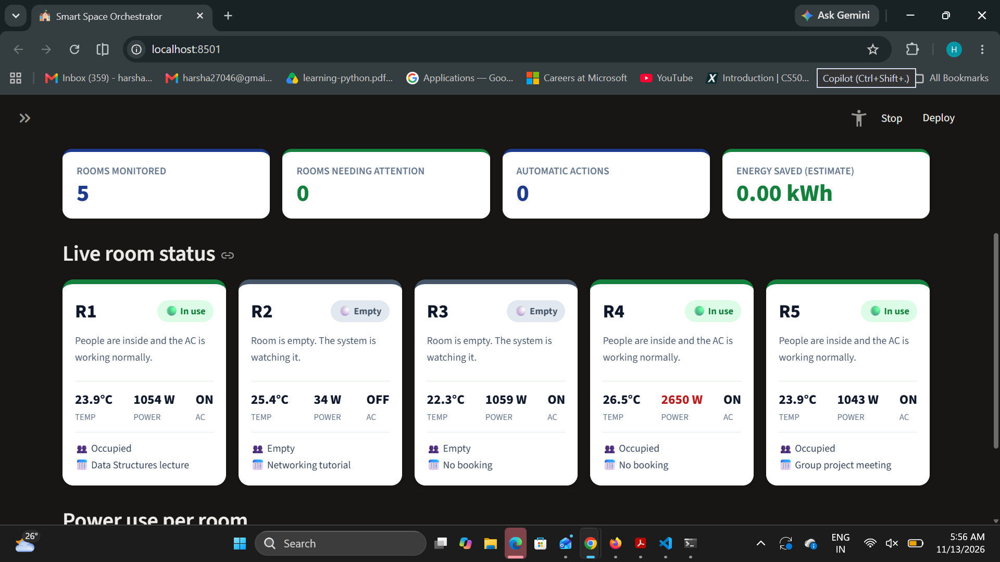

# Smart Space Orchestrator

**Track:** Intelligent Automation & Digital Transformation
**APU Cloud Innovation Hackathon 2026 | Team: girleypop coderz**

Campuses waste energy and room capacity because nobody sees what is happening in real time: rooms are booked but empty, air conditioners run in empty rooms, and equipment faults are found late. Smart Space Orchestrator watches rooms through connected sensors, decides automatically, and sends commands back to the devices.



## What it does

- **Frees no-show bookings:** a room that is booked but stays empty is released for others.
- **Saves energy:** an empty room with the AC running gets an automatic "AC off" command, and the device responds.
- **Catches faults early:** abnormal power use together with rising temperature raises an alert, and Gemini explains the likely cause and the recommended action.
- **Live dashboard:** room status, automatic actions, pop-up notifications and estimated energy saved.

## How it works

1. **Sensors** (simulated) publish temperature, power use and occupancy for each room over **MQTT**.
2. **The brain** (`brain.py`) receives the data and applies rules for the clear cases. **Gemini** is used only to explain suspicious readings in plain language.
3. **Devices act:** commands travel back over MQTT and the simulated AC switches off.
4. **The dashboard** (`dashboard.py`, built with Streamlit) shows everything live.

```
Sensors -> MQTT broker -> Brain (rules + Gemini) -> Commands back to devices
                                  |
                               SQLite -> Dashboard
```

## Tech stack

Python, MQTT (paho-mqtt, HiveMQ public broker), Google Gemini API, SQLite, Streamlit, pandas.

## How to run

Requires Python 3.10 or newer and a free Gemini API key from Google AI Studio (aistudio.google.com).

```
cd smartspace
pip install -r requirements.txt
```

Set the API key. This is optional: without it, a built-in fallback message is used.

- Windows PowerShell: `$env:GEMINI_API_KEY="your-key"`
- Mac or Linux: `export GEMINI_API_KEY="your-key"`

Change `PREFIX` in `config.py` to something unique to you. Then run each command in its own terminal, in this order:

```
python brain.py
python simulator.py
streamlit run dashboard.py
```

Open the dashboard and press **Start demo**. Events happen at about 30 seconds (fault alert), 60 seconds (booking released) and 90 seconds (AC switched off). Press **Restart demo** to replay.

## Important notes

- **All sensor data is simulated.** No real student or building data is used.
- Demo time is compressed: the demo seconds stand for real minutes.
- The energy saving figure is an **estimate** (it assumes the AC would have run one more hour).
- The public MQTT broker is for demo purposes only. A real deployment would use a managed, secured broker.

## Real-world rollout and next steps

- Replace the simulator with ESP32 occupancy, temperature and power sensors.
- Use a managed cloud MQTT service with authentication.
- Keep humans in the loop for high-impact actions, such as staff approval before a booking is released.
- Connect to the real room-booking system and add maintenance ticketing.

## Team

Harsha Hari
Kanika Rajput
Shurkila Ngangbam